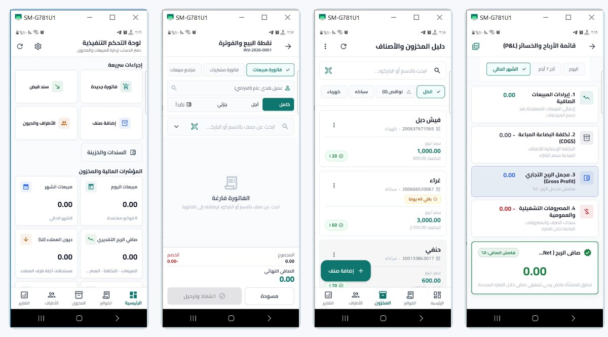

# دفتر الحساب | Daftar Al-Hesab

**تطبيق محاسبي عربي لإدارة المبيعات والمشتريات والمخزون والتقارير**

**تطوير:** وهيب الكبودي | Wahib Al-Kaboudi  
**المنصة:** Android / Flutter  
**التقنيات:** Flutter · Dart · SQLite · PDF · Barcode

## نبذة عن المشروع

دفتر الحساب تطبيق محاسبي للهواتف يساعد على تسجيل العمليات التجارية ومتابعة حركة المخزون والأطراف المالية، مع تقارير عملية للمراجعة اليومية.

## الوظائف والمكونات الأساسية

- إدارة فواتير البيع والشراء والمرتجعات.
- دليل الأصناف وحركة المخزون والباركود.
- إدارة العملاء والموردين وسندات القبض والصرف.
- تقارير الأرباح والخسائر والملخصات المحاسبية.
- تخزين محلي واختبارات للعمليات الحرجة.

## صور ومخططات المشروع



### بقية الواجهات

- [01 dashboard](screenshots/01-dashboard.png)
- [02 store settings](screenshots/02-store-settings.png)
- [03 invoices](screenshots/03-invoices.png)
- [04 point of sale](screenshots/04-point-of-sale.png)
- [05 inventory](screenshots/05-inventory.png)
- [06 add item](screenshots/06-add-item.png)
- [07 parties](screenshots/07-parties.png)
- [08 add customer](screenshots/08-add-customer.png)
- [09 profit loss](screenshots/09-profit-loss.png)
- [10 reports](screenshots/10-reports.png)
- [11 receipt voucher](screenshots/11-receipt-voucher.png)
- [12 payment voucher](screenshots/12-payment-voucher.png)

## التقنيات المستخدمة

Flutter · Dart · SQLite · PDF · Barcode

## التشغيل محليًا

```bash
flutter pub get
flutter run
```

## حالة المشروع وحدوده

هذا مستودع مصدر للتطوير والمراجعة، وليس نسخة تجارية موقّعة جاهزة للتوزيع. بعض مسارات الترخيص والطباعة والباركود تحتاج إلى إعداد واختبار على الأجهزة المستهدفة.

## المطور وحقوق النشر

**وهيب الكبودي | Wahib Al-Kaboudi**  
Copyright © 2026 Wahib Al-Kaboudi. All rights reserved.

ما لم يُذكر ترخيص صريح آخر للملفات أو التبعيات، فإن نشر المصدر هنا لا يمنح تلقائيًا إذنًا بإعادة توزيعه أو استخدامه تجاريًا. تُحترم تراخيص المكتبات والبيانات والمكونات الخارجية كلٌّ بحسب شروطه.
